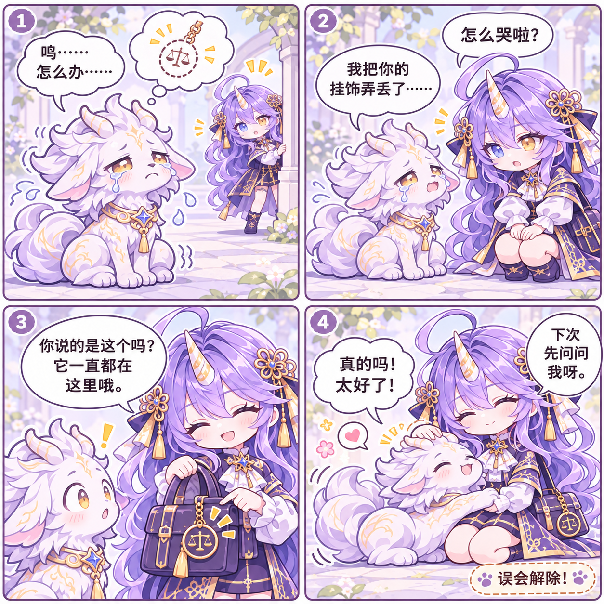

# Lawlearn Art

Lawlearn 的**艺术资源、角色档案与世界观设定**仓库。

这里集中存放与 Lawlearn 相关的角色立绘、头像、图标、品牌视觉，以及角色性格与说话方式的设定，方便后续补充、整理和对外展示。

## 四格漫画

<a href="Assets/Comics/挂饰误会/zh.png"></a>

《挂饰误会》（2026-11-07）· 夏珩与夏依恩 · 中文版（1254 × 1254）。[查看原图](Assets/Comics/挂饰误会/zh.png) · [日文版](Assets/Comics/挂饰误会/ja.png)

《法律学习与短视频风波》（2026-11-08）· 作者 / 夏珩 / 伊诗雅 · [中文版](Assets/Comics/法律学习与短视频风波/zh.png) / [日文版](Assets/Comics/法律学习与短视频风波/ja.png) / [德语版](Assets/Comics/法律学习与短视频风波/de.png)（1254 × 1254）。[漫画目录](Assets/Comics/README.md)

《降温的好处》（2026-11-09）· 作者 / 夏珩 / 伊诗雅 · 中文版（1254 × 1254）。[查看原图](Assets/Comics/降温的好处/zh.png)

《劳逸结合》（2026-11-09）· 作者 / 夏珩 / 伊诗雅 · 中文版（1254 × 1254）。[查看原图](Assets/Comics/劳逸结合/zh.png)

《忘带伞》（2026-11-10）· 作者 / 夏珩 / 伊诗雅 · 中文版（1254 × 1254）。[查看原图](Assets/Comics/忘带伞/zh.png)

> 当前内容最初整理自 [`QuotOS-Aurora-Lab/Lawlearn_Mac`](https://github.com/QuotOS-Aurora-Lab/Lawlearn_Mac)（commit `ef61355`），后续会继续补充世界观、表情包、四格漫画等内容。

## 目录

```text
.
├── Characters/          # 角色档案：性格、语气、角色提示词与素材索引
├── Worldbuilding/       # 世界观设定：神话、组织、时间线、术语
│   └── mythology/       # 神话与起源档案
├── Assets/
│   ├── Characters/      # 角色立绘、头像、图标与设定图
│   ├── Icons/           # Lawlearn 应用内图标
│   ├── Brand/           # 品牌视觉、App 图标、广告片
│   ├── Expressions/     # 表情包
│   └── Comics/          # 四格漫画
└── LICENSE
```

## 角色

| 角色 | 英文名 / 内部 id | 人设简介 | 档案 |
|---|---|---|---|
| **谢辞希** | Cecil / `cecil` | 英伦毒舌管家。冷静、克制、护短，措辞讲究，习惯称你一声「阁下」；先替你解决问题，再谈风度。 | [Characters/Cecil.md](Characters/Cecil.md) |
| **伊诗雅** | Aetheria / `aetheria` | 傲娇章鱼女仆。嘴上不饶人，心里全是照看；越是嘴硬，越在关键时刻把你护得好好的。 | [Characters/Aetheria.md](Characters/Aetheria.md) |
| **罗亘斯** | Nox / `nox` | 无性别数据幽灵。住在电脑里的粉紫色小幽灵，软软糯糯、说话慢半拍；别被呆萌骗了，关键时刻一句就说到点子上。 | [Characters/Nox.md](Characters/Nox.md) |
| **夏依恩** | Scheien / `scheien` | 獬豸化形的大小姐。傲娇毒舌、讲究格式，一个标点都不肯放过；嘴上刻薄，真遇上不公，第一个替你出头。 | [Characters/Scheien.md](Characters/Scheien.md) |
| **夏珩** | Scheng（世界观角色） | 初代法理獬豸与雪原狼王的后裔。通体雪白、头顶独角、金瞳；「触不直者，断不平事」。 | [Characters/Scheng.md](Characters/Scheng.md) |

## 资源说明

- `Assets/Characters/<角色>/` 内包含：
  - `*_master.png`：1254 × 1254 角色主立绘
  - `*_color.png`：160 × 160 彩色头像
  - `*_ic.svg`：2048 × 2048 矢量图标
  - 部分角色另有 `Humanoid/`、`Beast/`、`Moe/`、`Ori/` 等设定图子目录
- `Characters/aether_presets.json` 是角色行为设定的原始数据，包含 system prompt、称呼、口头禅与角色互动内容。
- `Assets/Icons/` 为 Lawlearn 应用内使用的法务与角色图标。
- `Assets/Brand/` 另含 App 图标、版本演进图和广告片 `Lawlearn_Ad.mp4`。

## 补充约定

- 新增角色时，在 `Characters/` 下新增角色档案，并在 `Assets/Characters/<角色>/` 放对应素材。
- 新增表情包放 `Assets/Expressions/`，四格漫画放 `Assets/Comics/`。
- 世界观、神话体系、组织与时间线统一放 `Worldbuilding/`。

## License

本仓库内容默认保留所有权利，具体使用范围见 [LICENSE](LICENSE)。如需采用其他授权方式，可后续替换。
